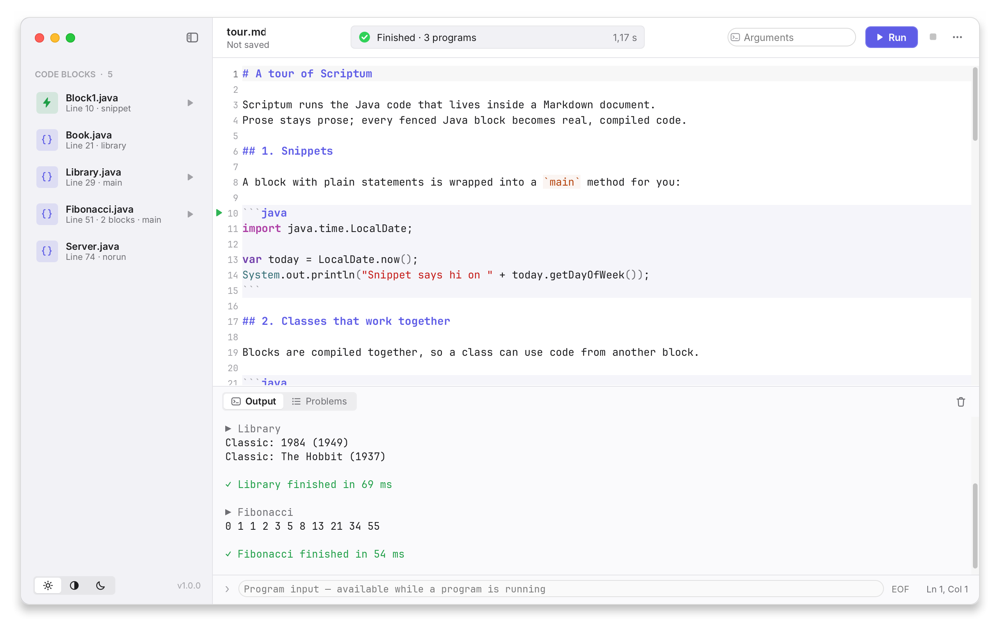
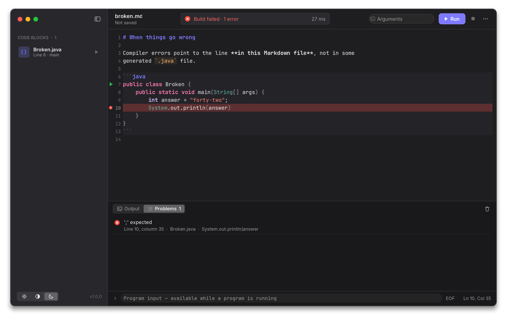
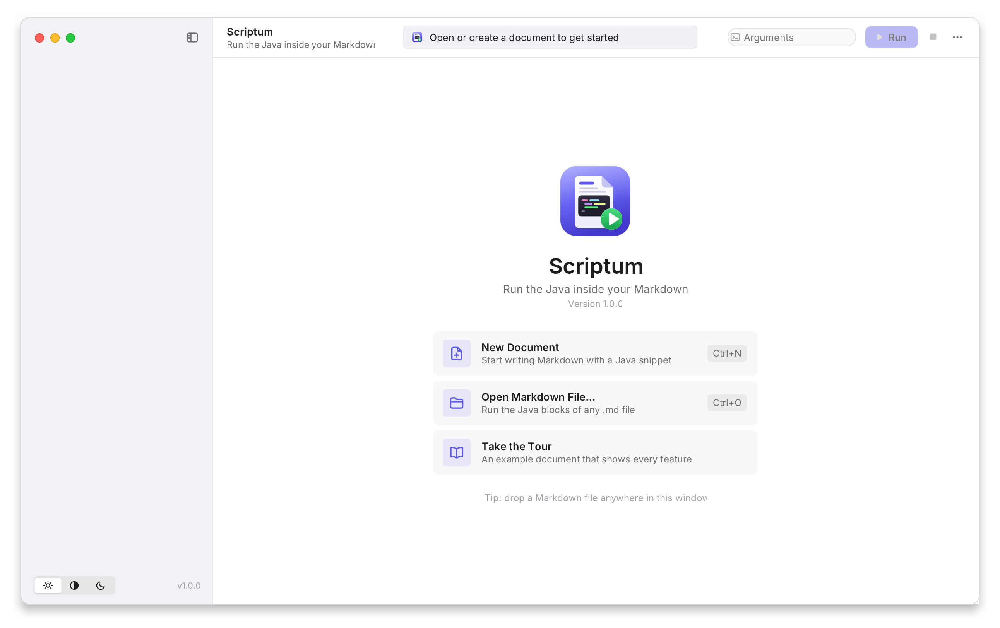
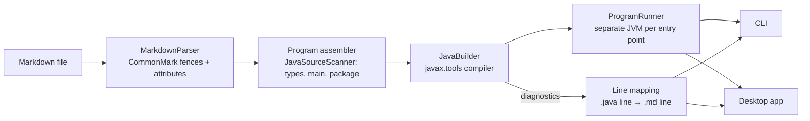

<div align="center">


# Scriptum

**Run the Java inside your Markdown.**

Write notes, tutorials or homework in Markdown, keep real Java next to the text,
and run it all with one click — or one command.

[](https://github.com/Zhumanio08/Scriptum/actions/workflows/ci.yml)


[](LICENSE)

[Русская версия](README.ru.md)

<picture>
  <source media="(prefers-color-scheme: dark)" srcset="docs/images/app-dark.png">
  
</picture>

</div>

## Why

Markdown is where we explain code — READMEs, lecture notes, blog drafts, exercises.
But the code in those files is dead text: it silently goes stale, and to try it you
copy-paste it into an IDE.

Scriptum makes the document itself runnable. It finds every ` ```java ` block,
compiles them **together** (so blocks can use each other), runs every class with a
`main` method and shows compiler errors **at the right line of the Markdown file**.

## Features

- 🖥 **Desktop app** with a macOS-style design on every OS: rounded window with a soft
  shadow and traffic-light buttons, light / dark / system appearance.
- ✍️ **Markdown editor** with real Java syntax highlighting *inside* code fences,
  line numbers and a ▶ button next to every runnable class.
- 🧩 **Code-block sidebar** — every generated `.java` file at a glance; click to jump,
  ▶ to run just that one.
- 📟 **Live console** that streams output, highlights `stderr`, lets you type into the
  program's **stdin**, and turns stack-trace lines into links back to the Markdown.
- 🎯 **Errors in Markdown coordinates** — the Problems list and the editor point to the
  exact line and column of your `.md` file.
- ⚡ **Snippets** — a block with plain statements is wrapped into `main` for you:
  ` ```java ` + `System.out.println("hi");` just works.
- 🧱 **Real Java**: multiple classes, records, enums, packages, Java 25 compact source
  files (`void main()`), blocks split across the text and merged back together.
- ⌨️ **CLI** for terminals, scripts and CI: colored output, `--list`, `--timeout`,
  `--out`, program arguments, meaningful exit codes.
- 🧼 Runs in a temporary directory — nothing is written next to your files.

<table>
  <tr>
    <td></td>
    <td></td>
  </tr>
  <tr>
    <td align="center"><sub>Compiler errors point to the Markdown line</sub></td>
    <td align="center"><sub>Welcome screen</sub></td>
  </tr>
</table>

## Install

You need a **JDK 17 or newer** (a JDK, not just a JRE — Scriptum compiles code) and **git**.
Maven is optional: the installer downloads it if needed.

**Linux / macOS**

```bash
curl -fsSL https://raw.githubusercontent.com/Zhumanio08/Scriptum/master/install.sh | bash
```

**Windows** (PowerShell)

```powershell
irm https://raw.githubusercontent.com/Zhumanio08/Scriptum/master/install.bat -OutFile install.bat; .\install.bat
```

The installer builds Scriptum from source and adds the `scriptum` command
(plus an app-menu / Start-menu launcher for the desktop app). Run it again to update.

<details>
<summary>Installing a JDK</summary>

| OS              | Command                                                  |
|-----------------|----------------------------------------------------------|
| Debian / Ubuntu | `sudo apt install -y openjdk-17-jdk git`                 |
| Fedora          | `sudo dnf install -y java-17-openjdk-devel git`          |
| Arch            | `sudo pacman -S --noconfirm jdk17-openjdk git`           |
| macOS           | `brew install openjdk@17 git`                            |
| Windows         | `winget install EclipseAdoptium.Temurin.17.JDK Git.Git`  |

If the shell can't find `scriptum` afterwards, add `~/.local/bin` to your `PATH`
(the installer prints the exact line).
</details>

<details>
<summary>Without the installer</summary>

```bash
git clone https://github.com/Zhumanio08/Scriptum.git
cd Scriptum
mvn package                         # builds target/scriptum.jar (one runnable JAR)
java -jar target/scriptum.jar gui   # desktop app
java -jar target/scriptum.jar examples/tour.md
```

Double-clicking `scriptum.jar` opens the desktop app as well.
</details>

## Using the desktop app

```bash
scriptum gui              # or launch "Scriptum" from the app menu
scriptum gui notes.md     # open a file directly
```

Open a Markdown file (or drop it onto the window), press **Run**, read the output.
New to it? Click **Take the Tour** on the welcome screen.

| Action                  | macOS | Linux / Windows       |
|-------------------------|-------|-----------------------|
| Run all blocks          | ⌘R    | Ctrl+R or F5          |
| Stop                    | ⌘.    | Ctrl+.                |
| New / Open / Save       | ⌘N / ⌘O / ⌘S | Ctrl+N / Ctrl+O / Ctrl+S |
| Save As                 | ⇧⌘S   | Ctrl+Shift+S          |
| Export generated `.java` files | ⇧⌘E | Ctrl+Shift+E   |
| Clear console           | ⇧⌘K   | Ctrl+Shift+K          |
| Toggle sidebar          | ⌘0    | Ctrl+0                |

Program arguments go into the **Arguments** field in the toolbar (quotes work as in a
shell). While a program runs, type into the input line under the console to feed its
stdin; **EOF** closes the input.

> On tiling window managers you may prefer the system title bar:
> start with `SCRIPTUM_NATIVE_FRAME=1 scriptum gui`.

## Using the command line

```text
$ scriptum examples/tour.md
 Scriptum  tour.md  7 blocks → Block1.java, Book.java, Library.java, Fibonacci.java, Server.java
✓ Compiled 5 files in 763 ms

▶ Block1  line 10
Snippet says hi on MONDAY
✓ Block1 finished in 79 ms

▶ Library  line 32
Classic: 1984 (1949)
Classic: The Hobbit (1937)
✓ Library finished in 45 ms
...
```

```text
$ scriptum examples/broken.md
error broken.md:10:35  (Broken.java)
  ';' expected
 10 │         System.out.println(answer)
    │                                   ^
✗ Build failed — 1 error
```

| Option | Meaning |
|---|---|
| `-l, --list` | show the blocks and entry points, don't run anything |
| `-r, --run <Class>` | run only this class (repeatable) |
| `-o, --out <dir>` | also export the generated `.java` files to `<dir>` |
| `-k, --keep` | keep the temporary build directory |
| `-t, --timeout <sec>` | stop a program that runs longer than this |
| `-q, --quiet` | print only the programs' own output |
| `--no-color` | disable colors (`NO_COLOR` is honored too) |
| `-- <args...>` | arguments passed to every program |
| `-` (as the file) | read Markdown from stdin |

Scriptum's own status lines go to **stderr**, the programs' output to **stdout** —
so `scriptum notes.md > out.txt` captures exactly what your code printed.

Exit codes: `0` success · `1` a program failed · `2` usage error · `3` compilation
failed · `124` timeout.

## Writing documents

Any fenced block tagged `java` becomes code. Everything else is ignored.

````markdown
A snippet — statements are wrapped into `main` automatically:

```java
var langs = java.util.List.of("Java", "Markdown");
System.out.println(String.join(" + ", langs));
```

Classes in different blocks are compiled together:

```java
record Point(int x, int y) {}
```

```java
public class Main {
    public static void main(String[] args) {
        System.out.println(new Point(1, 2));
    }
}
```
````

| You write | Scriptum does |
|---|---|
| ` ```java ` with classes | saves them as `<PublicClass or FirstClass>.java` and runs every class that declares `main` |
| ` ```java ` with plain statements | wraps them into `public class BlockN { main(...) }`, keeping `import`s on top |
| ` ```java ` with top-level methods (`void main()`) | treats it as a Java 25 compact source file |
| ` ```java class="Story" ` (or `name=`) | names the file; blocks with the **same name are merged**, so one class can be explained piece by piece |
| ` ```java norun ` | compiles the block but doesn't launch its `main` |
| ` ```java skip ` | ignores the block (pseudo-code, intentionally broken examples) |
| `package com.acme;` | places the file in `com/acme/` and runs `com.acme.App` |

Fences follow CommonMark: ` ``` ` or `~~~`, any indentation, and a longer fence
(` ```` `) can contain ` ``` ` examples without them being executed.

See [`examples/`](examples) — `tour.md` shows every feature.

## How it works



1. **Parse.** `MarkdownParser` extracts ` ```java ` fences with their attributes,
   following the CommonMark rules for fence length, `~~~` and indentation.
2. **Assemble.** Blocks are grouped into source files. `JavaSourceScanner` — a small
   tolerant scanner that masks comments and string literals and tracks brace depth —
   finds top-level types, `main` methods, packages and snippets. Every generated line
   remembers the Markdown line it came from.
3. **Compile.** `JavaBuilder` uses the in-process compiler from `javax.tools`
   (falling back to an external `javac`) and translates each diagnostic back into
   Markdown coordinates.
4. **Run.** Each entry point runs in its own JVM. The CLI inherits the terminal;
   the desktop app streams stdout/stderr on background threads and batches them into
   the console every 40 ms, so even very chatty programs keep the UI responsive.

### Desktop app internals

- **Swing + [FlatLaf](https://www.formdev.com/flatlaf/)** (macOS light/dark themes),
  bundled Inter and JetBrains Mono fonts so the app looks the same everywhere.
- **Custom window** (`MacWindow`): on Linux/Windows an undecorated, per-pixel
  translucent frame with a cached 9-slice Gaussian shadow, rounded body, hand-drawn
  traffic lights, edge resizing, drag-to-move and double-click-to-zoom. On macOS the
  native window with a transparent full-size title bar is used instead.
- **Editor** on [RSyntaxTextArea](https://github.com/bobbylight/RSyntaxTextArea) with a
  custom `TokenMaker` that delegates prose to the Markdown lexer and fenced code to the
  Java lexer, carrying both lexers' multi-line state across lines.
- Hand-made SVG icon set and app icon; Xcode-style activity indicator in the toolbar.

### Project layout

```text
src/main/java/live/justzhuman/scriptum/
├── Launcher.java              entry point: CLI or GUI
├── core/                      no UI code — usable as a library
│   ├── MarkdownParser.java    CommonMark fences → CodeBlock
│   ├── JavaSourceScanner.java types, main, package, snippets
│   ├── Program.java           blocks → SourceUnit files + entry points
│   ├── JavaBuilder.java       compile + map diagnostics to Markdown lines
│   ├── ProgramRunner.java     launch / kill programs, argument splitting
│   └── Workspace.java, Toolchain.java, …
├── cli/                       argument parsing, colored terminal output
└── gui/                       window, editor, sidebar, console, theme
examples/                      sample documents (bundled into the app)
packaging/                     app icon, jpackage script
```

## Development

```bash
mvn package           # compile, run the tests, build target/scriptum.jar
mvn test              # tests only: parser, scanner, line mapping, end-to-end compile & run
```

Regenerate the screenshots in this README (renders the window off-screen):

```bash
mvn package && java -cp target/scriptum.jar:target/test-classes \
    live.justzhuman.scriptum.gui.Screenshots docs/images
```

Build a self-contained native app (bundles a Java runtime, uses `jpackage`):

```bash
./packaging/package.sh          # app image in dist/
./packaging/package.sh dmg      # or deb, rpm, msi, exe, pkg
```

CI builds and tests on Linux, macOS and Windows with Java 17 and 21; pushing a `v*`
tag publishes `scriptum.jar` as a GitHub release.

## License

[MIT](LICENSE)
