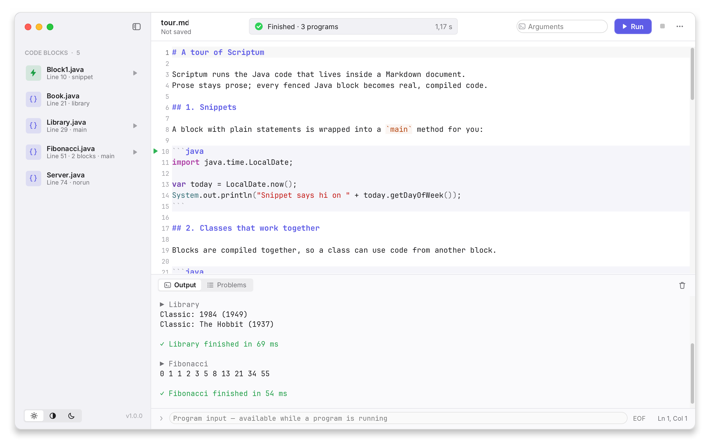
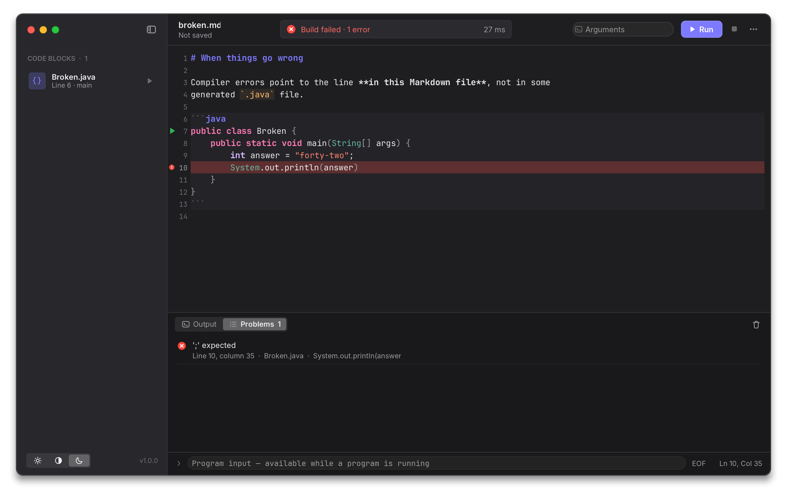
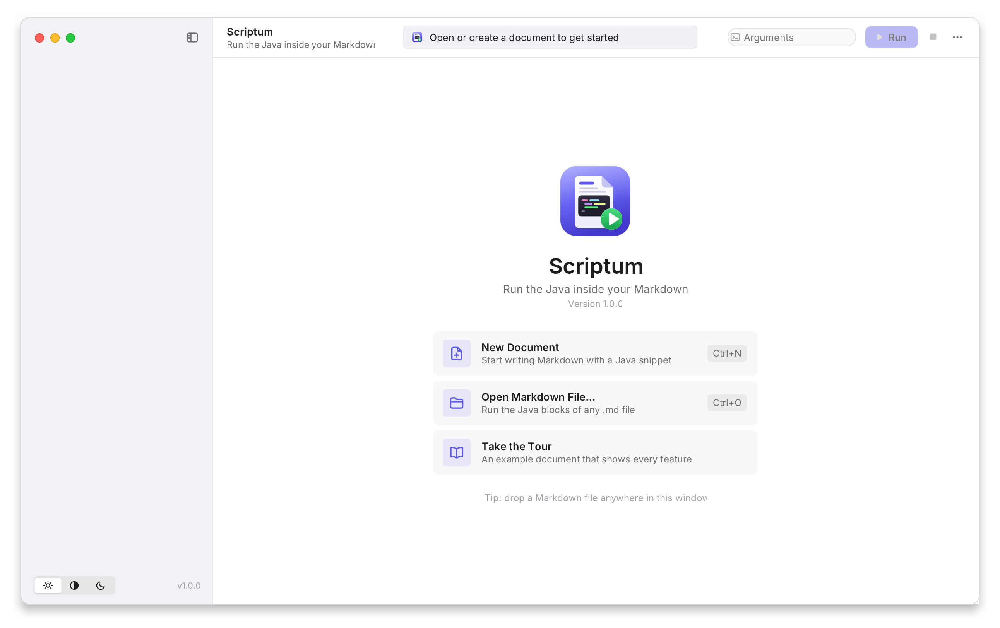
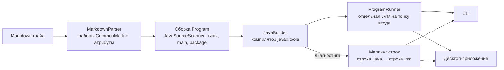

<div align="center">


# Scriptum

**Запускай Java-код прямо из Markdown.**

Пиши конспекты, туториалы и домашние задания в Markdown, держи настоящий Java-код
рядом с текстом и запускай всё одной кнопкой — или одной командой.

[](https://github.com/Zhumanio08/Scriptum/actions/workflows/ci.yml)


[](LICENSE)

[English version](README.md)

<picture>
  <source media="(prefers-color-scheme: dark)" srcset="docs/images/app-dark.png">
  
</picture>

</div>

## Зачем

В Markdown мы объясняем код: README, конспекты лекций, статьи, задачи. Но код в таких
файлах — мёртвый текст: он незаметно устаревает, а чтобы его попробовать, приходится
копировать его в IDE.

Scriptum делает сам документ исполняемым. Он находит все блоки ` ```java `,
компилирует их **вместе** (блоки видят друг друга), запускает каждый класс с методом
`main` и показывает ошибки компиляции **на нужной строке Markdown-файла**.

## Возможности

- 🖥 **Десктоп-приложение** с дизайном в стиле macOS на любой ОС: скруглённое окно
  с мягкой тенью и «светофором», светлая / тёмная / системная тема.
- ✍️ **Редактор Markdown** с настоящей подсветкой Java *внутри* блоков кода, номерами
  строк и кнопкой ▶ у каждого запускаемого класса.
- 🧩 **Сайдбар блоков** — все генерируемые `.java`-файлы; клик — переход к блоку,
  ▶ — запуск только его.
- 📟 **Живая консоль**: потоковый вывод, `stderr` красным, ввод в **stdin** программы,
  строки стек-трейса — ссылки обратно в Markdown.
- 🎯 **Ошибки в координатах Markdown**: список Problems и редактор указывают точную
  строку и столбец в `.md`-файле.
- ⚡ **Сниппеты**: блок из обычных инструкций сам оборачивается в `main` —
  ` ```java ` + `System.out.println("hi");` просто работает.
- 🧱 **Настоящая Java**: несколько классов, records, enum, пакеты, compact source files
  из Java 25 (`void main()`), класс, разбитый на несколько блоков по тексту.
- ⌨️ **CLI** для терминала, скриптов и CI: цветной вывод, `--list`, `--timeout`,
  `--out`, аргументы программы, осмысленные коды выхода.
- 🧼 Всё собирается во временной папке — рядом с вашими файлами ничего не появляется.

<table>
  <tr>
    <td></td>
    <td></td>
  </tr>
  <tr>
    <td align="center"><sub>Ошибки указывают на строку в Markdown</sub></td>
    <td align="center"><sub>Экран приветствия</sub></td>
  </tr>
</table>

## Установка

Нужны **JDK 17 или новее** (именно JDK, не JRE — Scriptum компилирует код) и **git**.
Maven не обязателен: установщик скачает его сам.

**Linux / macOS**

```bash
curl -fsSL https://raw.githubusercontent.com/Zhumanio08/Scriptum/master/install.sh | bash
```

**Windows** (PowerShell)

```powershell
irm https://raw.githubusercontent.com/Zhumanio08/Scriptum/master/install.bat -OutFile install.bat; .\install.bat
```

Установщик собирает Scriptum из исходников, добавляет команду `scriptum` и ярлык
приложения в меню (Linux) / меню «Пуск» (Windows). Для обновления запусти его ещё раз.

<details>
<summary>Как поставить JDK</summary>

| ОС              | Команда                                                  |
|-----------------|----------------------------------------------------------|
| Debian / Ubuntu | `sudo apt install -y openjdk-17-jdk git`                 |
| Fedora          | `sudo dnf install -y java-17-openjdk-devel git`          |
| Arch            | `sudo pacman -S --noconfirm jdk17-openjdk git`           |
| macOS           | `brew install openjdk@17 git`                            |
| Windows         | `winget install EclipseAdoptium.Temurin.17.JDK Git.Git`  |

Если после установки shell не находит `scriptum`, добавь `~/.local/bin` в `PATH`
(установщик печатает точную команду).
</details>

<details>
<summary>Без установщика</summary>

```bash
git clone https://github.com/Zhumanio08/Scriptum.git
cd Scriptum
mvn package                         # собирает target/scriptum.jar (один запускаемый JAR)
java -jar target/scriptum.jar gui   # десктоп-приложение
java -jar target/scriptum.jar examples/tour.md
```

Двойной клик по `scriptum.jar` тоже открывает приложение.
</details>

## Десктоп-приложение

```bash
scriptum gui              # или «Scriptum» в меню приложений
scriptum gui notes.md     # сразу открыть файл
```

Открой Markdown-файл (или перетащи его в окно), нажми **Run** и смотри вывод.
Впервые? Нажми **Take the Tour** на экране приветствия.

| Действие                | macOS | Linux / Windows       |
|-------------------------|-------|-----------------------|
| Запустить все блоки     | ⌘R    | Ctrl+R или F5         |
| Остановить              | ⌘.    | Ctrl+.                |
| Новый / Открыть / Сохранить | ⌘N / ⌘O / ⌘S | Ctrl+N / Ctrl+O / Ctrl+S |
| Сохранить как           | ⇧⌘S   | Ctrl+Shift+S          |
| Экспорт `.java`-файлов  | ⇧⌘E   | Ctrl+Shift+E          |
| Очистить консоль        | ⇧⌘K   | Ctrl+Shift+K          |
| Показать/скрыть сайдбар | ⌘0    | Ctrl+0                |

Аргументы программы вводятся в поле **Arguments** на панели инструментов (кавычки
работают как в shell). Пока программа работает, строка под консолью отправляет текст
в её stdin; кнопка **EOF** закрывает ввод.

> В тайлинговых оконных менеджерах удобнее системная рамка окна:
> `SCRIPTUM_NATIVE_FRAME=1 scriptum gui`.

## Командная строка

```text
$ scriptum examples/tour.md
 Scriptum  tour.md  7 blocks → Block1.java, Book.java, Library.java, Fibonacci.java, Server.java
✓ Compiled 5 files in 763 ms

▶ Block1  line 10
Snippet says hi on MONDAY
✓ Block1 finished in 79 ms
...
```

```text
$ scriptum examples/broken.md
error broken.md:10:35  (Broken.java)
  ';' expected
 10 │         System.out.println(answer)
    │                                   ^
✗ Build failed — 1 error
```

| Опция | Что делает |
|---|---|
| `-l, --list` | показать блоки и точки входа, ничего не запуская |
| `-r, --run <Class>` | запустить только этот класс (можно несколько раз) |
| `-o, --out <dir>` | дополнительно сохранить сгенерированные `.java` в `<dir>` |
| `-k, --keep` | не удалять временную папку сборки |
| `-t, --timeout <sec>` | остановить программу, если она работает дольше |
| `-q, --quiet` | печатать только вывод самих программ |
| `--no-color` | без цветов (переменная `NO_COLOR` тоже учитывается) |
| `-- <args...>` | аргументы, передаваемые каждой программе |
| `-` вместо файла | читать Markdown из stdin |

Служебные сообщения Scriptum идут в **stderr**, вывод программ — в **stdout**, поэтому
`scriptum notes.md > out.txt` сохранит ровно то, что напечатал ваш код.

Коды выхода: `0` успех · `1` программа завершилась с ошибкой · `2` ошибка запуска ·
`3` ошибка компиляции · `124` таймаут.

## Как писать документы

Каждый блок с языком `java` становится кодом, всё остальное игнорируется.

| Что пишешь | Что делает Scriptum |
|---|---|
| ` ```java ` с классами | сохраняет как `<публичный или первый класс>.java` и запускает каждый класс с `main` |
| ` ```java ` с обычными инструкциями | оборачивает в `public class BlockN { main(...) }`, `import` поднимаются наверх |
| ` ```java ` с методами верхнего уровня (`void main()`) | считает это compact source file из Java 25 |
| ` ```java class="Story" ` (или `name=`) | задаёт имя файла; блоки с **одинаковым именем склеиваются**, так класс можно объяснять по частям |
| ` ```java norun ` | компилирует блок, но не запускает его `main` |
| ` ```java skip ` | полностью игнорирует блок (псевдокод, заведомо сломанные примеры) |
| `package com.acme;` | кладёт файл в `com/acme/` и запускает `com.acme.App` |

Блоки разбираются по правилам CommonMark: ` ``` ` или `~~~`, любой отступ, а внутри более
длинного забора (` ```` `) можно показывать примеры с ` ``` `, и они не выполнятся.

Примеры — в папке [`examples/`](examples), `tour.md` показывает все возможности.

## Как это устроено



1. **Разбор.** `MarkdownParser` извлекает блоки ` ```java ` с атрибутами по правилам
   CommonMark (длина забора, `~~~`, отступы).
2. **Сборка.** Блоки группируются в исходные файлы. `JavaSourceScanner` — небольшой
   устойчивый к ошибкам сканер, который маскирует комментарии и строки и считает
   глубину скобок, — находит типы верхнего уровня, методы `main`, пакеты и сниппеты.
   Каждая сгенерированная строка помнит, из какой строки Markdown она пришла.
3. **Компиляция.** `JavaBuilder` использует встроенный компилятор `javax.tools`
   (с запасным вариантом через внешний `javac`) и переводит каждую ошибку обратно
   в координаты Markdown.
4. **Запуск.** Каждая точка входа запускается в отдельной JVM. CLI отдаёт ей терминал;
   приложение читает stdout/stderr в фоновых потоках и выводит их в консоль пачками
   раз в 40 мс, поэтому интерфейс не тормозит даже при огромном выводе.

### Устройство приложения

- **Swing + [FlatLaf](https://www.formdev.com/flatlaf/)** (темы macOS light/dark),
  встроенные шрифты Inter и JetBrains Mono — приложение одинаково выглядит везде.
- **Своё окно** (`MacWindow`): на Linux/Windows — окно без системной рамки с
  попиксельной прозрачностью, кэшированной 9-slice гауссовой тенью, скруглённым
  корпусом, нарисованным «светофором», ресайзом за края, перетаскиванием и зумом по
  двойному клику. На macOS используется нативное окно с прозрачным заголовком.
- **Редактор** на [RSyntaxTextArea](https://github.com/bobbylight/RSyntaxTextArea) со
  своим `TokenMaker`: текст отдаётся лексеру Markdown, код в заборах — лексеру Java,
  а многострочное состояние обоих переносится между строками.
- Собственный набор SVG-иконок и иконка приложения; индикатор активности в стиле Xcode.

### Структура проекта

```text
src/main/java/live/justzhuman/scriptum/
├── Launcher.java              точка входа: CLI или GUI
├── core/                      без UI — можно использовать как библиотеку
│   ├── MarkdownParser.java    заборы CommonMark → CodeBlock
│   ├── JavaSourceScanner.java типы, main, package, сниппеты
│   ├── Program.java           блоки → файлы SourceUnit + точки входа
│   ├── JavaBuilder.java       компиляция + маппинг ошибок на строки Markdown
│   ├── ProgramRunner.java     запуск / остановка программ, разбор аргументов
│   └── Workspace.java, Toolchain.java, …
├── cli/                       разбор аргументов, цветной вывод
└── gui/                       окно, редактор, сайдбар, консоль, тема
examples/                      примеры документов (встроены в приложение)
packaging/                     иконка, скрипт jpackage
```

## Разработка

```bash
mvn package           # компиляция, тесты, сборка target/scriptum.jar
mvn test              # только тесты: парсер, сканер, маппинг строк, сквозной compile & run
```

Пересоздать скриншоты для README (окно рендерится вне экрана):

```bash
mvn package && java -cp target/scriptum.jar:target/test-classes \
    live.justzhuman.scriptum.gui.Screenshots docs/images
```

Собрать самодостаточное нативное приложение (со встроенной Java, через `jpackage`):

```bash
./packaging/package.sh          # app image в dist/
./packaging/package.sh dmg      # или deb, rpm, msi, exe, pkg
```

CI собирает и тестирует проект на Linux, macOS и Windows с Java 17 и 21; тег `v*`
публикует `scriptum.jar` в GitHub Releases.

История ранних версий — в [`CHANGELOG.md`](CHANGELOG.md) и [`docs/devlog.ru.txt`](docs/devlog.ru.txt).

## Лицензия

[MIT](LICENSE)
